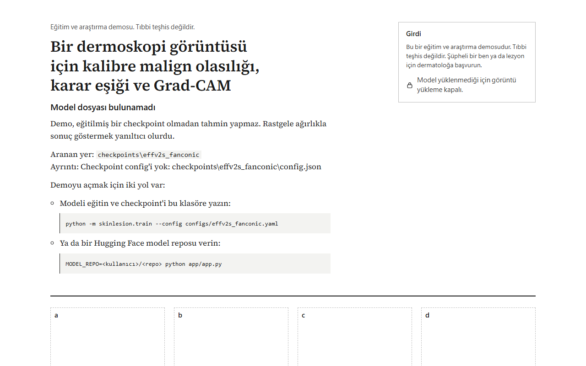
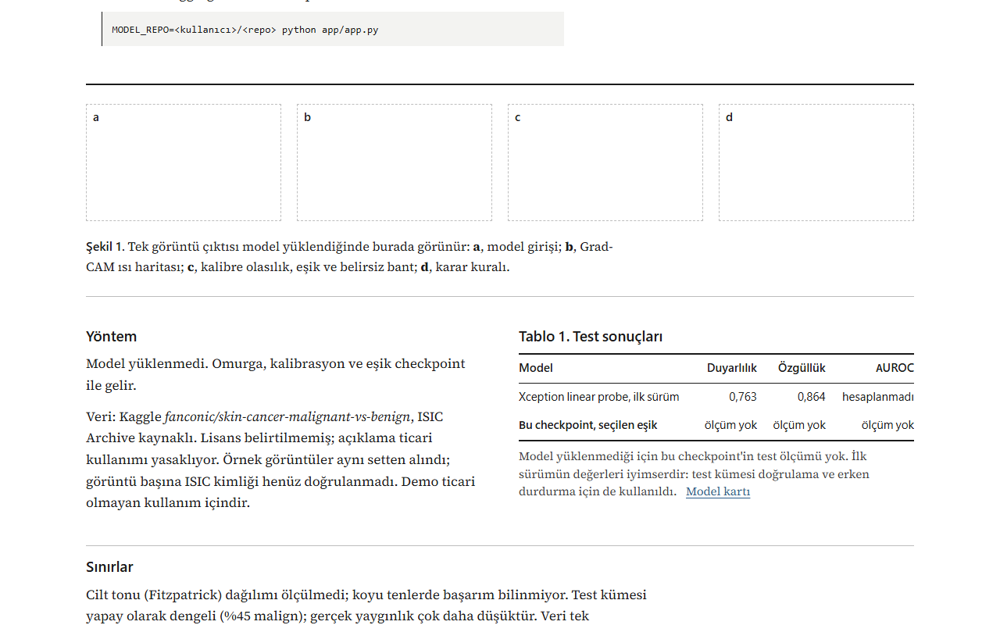
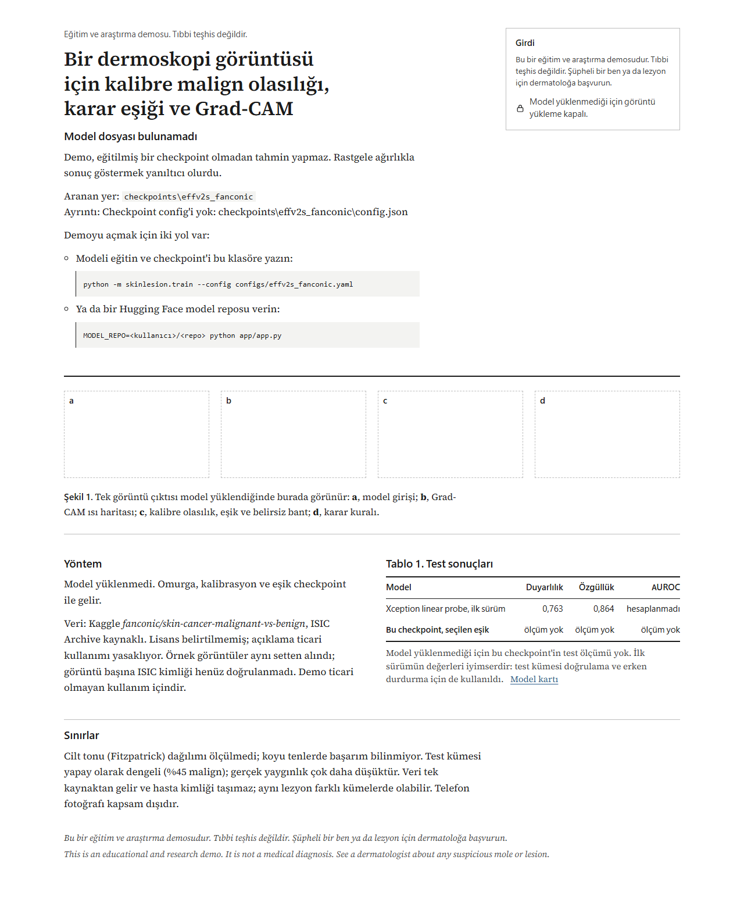
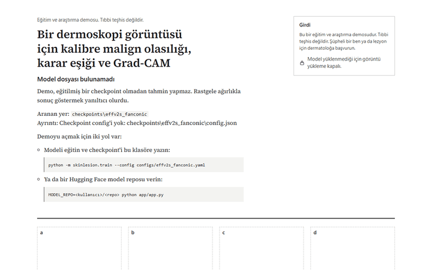

# Dermoskopi lezyon sınıflandırma (benign / malign)

[](https://github.com/rose-omer/Skin-Cancer-Classification/actions/workflows/ci.yml)
[](LICENSE)

> **Uyarı.** Bu bir eğitim ve araştırma demosudur. Tıbbi teşhis değildir.
> Şüpheli bir ben ya da lezyon için dermatoloğa başvurun.
>
> *This is an educational and research demo. It is not a medical diagnosis.*

Dermoskopi görüntüsünden kalibre malign olasılığı veren, eşiği doğrulama kümesinde seçen ve
kararını Grad-CAM ile gösteren tekrarlanabilir bir PyTorch/timm hattı.

## Ekran görüntüleri

Repoda eğitilmiş model dosyası yok. Görüntüler demonun model olmadan açıldığı durumu gösterir; şekil ve tablo bu yüzden boş.

| | |
|---|---|
| <br>Model dosyası yokken açılış | <br>Sonuç şekli ve tablo |
| <br>Tam sayfa |  |

## Kullanım



Uyarı onaylanır, dermoskopi görüntüsü yüklenir. Model varsa olasılık, eşik ve Grad-CAM şekli aynı sayfada çıkar.

## Sonuçlar

Aynı resmî test kümesi (Kaggle fanconic, 660 görüntü: 360 benign, 300 malign).

| Model | Eşik | AUROC | Duyarlılık | Özgüllük | ECE |
|---|---|---|---|---|---|
| Xception linear probe (ilk sürüm, `legacy/`) | 0.5 (argmax) | hesaplanmadı | 0.763 | 0.864 | hesaplanmadı |
| EfficientNetV2-S ince ayar | val'de seçilen | eğitim bekliyor | — | — | — |

- İlk sürümün değerleri iyimserdir: test kümesi doğrulama ve erken durdurma için de kullanıldı.
- Yeni modelin satırı elle yazılmaz. Eğitim ve son değerlendirmeden sonra tablo şu komutla üretilir:
  `uv run python -m skinlesion.evaluate --table`
- Test kümesi dengelidir (%45 malign). Gerçek yaygınlık çok daha düşüktür. Örnek: duyarlılık 0.763
  ve özgüllük 0.864 ile %1.8 yaygınlıkta (ISIC 2020) pozitif öngörü değeri yaklaşık %9 olur.
- İlk sürümdeki ResNet50 + XGBoost denemesinin 0.88 doğruluğu başka bir kümede (train'den rastgele
  %20) ölçüldü. Bu tabloyla karşılaştırılamaz.

## Yöntem

- **Bölünme.** Train klasöründen sınıf oranını koruyan %15 doğrulama kümesi ayrılır
  (`StratifiedShuffleSplit`, tohum 42). Resmî test kümesi yalnız iki komutta açılır:
  `skinlesion.evaluate --final` (ince ayar modeli) ve `skinlesion.embed --final` (embedding
  tabanı). İkisi de sonucu kaydeder ve ikinci koşuyu `--rerun-final` olmadan reddeder. Kod başka
  bir yerden test kümesini okumaya kalkarsa `TestSetAccessError` verir.
- **Kopya denetimi.** `skinlesion.dedup` her görüntü için sha256 ve 64 bit dHash hesaplar.
  Train–test arasında Hamming ≤ 4 olan çiftleri `reports/dedup.csv` dosyasına yazar.
  `skinlesion.data --exclude-dups` bu train görüntülerini train ve val'den çıkarır.
- **Eğitim.** `tf_efficientnetv2_s.in21k_ft_in1k` (Apache-2.0), giriş 224 px, omurganın kendi
  normalizasyonu. Önce 3 epoch yalnız baş, sonra bütün ağ (AdamW + cosine). Dengesizlik için
  `BCEWithLogitsLoss(pos_weight)`. Erken durdurma val AUROC'a göre; sayaç ince ayar aşamasında
  sıfırdan başlar.
- **Kalibrasyon.** Val kümesinde tek parametreli temperature scaling. ECE (15 kova) ve
  güvenilirlik diyagramı önce/sonra raporlanır.
- **Eşik.** Val kümesinde malign duyarlılığı ≥ 0.90 olan en yüksek eşik. Testte iki satır
  raporlanır: 0.5 eşiği ve seçilen eşik. Bütün ölçütlerde 1000 örnekli bootstrap %95 güven aralığı
  ve ISIC 2024 pAUC (TPR ≥ 0.80) vardır.
- **Grad-CAM.** Son evrişim aşaması hedeflenir. Isı haritası %40 saydamlıkla bindirilir. Demo ve
  rapor aynı fonksiyonu kullanır. Isı haritası tanı kanıtı değildir.
- **Belirsiz bant.** Varsayılan bant 0.30–0.70'tir; bant her zaman eşiği kapsayacak biçimde
  genişletilir. Böylece "düşük" sonuç hep eşiğin altında, "yüksek" sonuç hep eşiğin üstünde kalır.
  Demo bant ile eşik durumunu tek etikette gösterir: örneğin "Belirsiz, eşiğin üstünde".
- **Kapsam dışı girdi.** Dağılım train özelliklerinden (Ledoit-Wolf kovaryansı) kurulur. Eşik,
  val görüntülerinin Mahalanobis uzaklığının %99 yüzdeliğidir; train uzaklıkları görülmüş
  görüntülerden geldiği için küçük kalır. Val ve train yanlış alarm oranı `config.json`
  (`info.val`) içine yazılır. Uzaklık eşiği aşarsa demo "Bu görüntü dermoskopi görüntüsüne
  benzemiyor" uyarısı verir.
- **Temel model tabanı.** `skinlesion.embed` DINOv2 embedding'i üstüne `LogisticRegression`
  eğitir. Embedding önbelleği bölünme dosyasının sha256 özetine bağlıdır. Gated modeller
  (MedSigLIP, Derm Foundation) bu repoda indirilmez.

## Kurulum

Python 3.12 ve [uv](https://docs.astral.sh/uv/) gerekir. Torch CPU paketi kurulur.

```bash
git clone https://github.com/rose-omer/Skin-Cancer-Classification.git
cd Skin-Cancer-Classification
uv sync
```

## Veri

Kaggle hesabı ve `~/.kaggle/kaggle.json` gerekir.

```bash
uv run --with kaggle python -m skinlesion.download --out data
```

Beklenen düzen: `data/{train,test}/{benign,malignant}/*.jpg`. Veri repoya girmez.
Kaynak: [Kaggle fanconic/skin-cancer-malignant-vs-benign](https://www.kaggle.com/datasets/fanconic/skin-cancer-malignant-vs-benign)
(ISIC Archive kaynaklı; lisans belirtilmemiş, ticari kullanım yasak).

## Çalıştırma

```bash
uv run python -m skinlesion.dedup --data-root data --out reports/dedup.csv
uv run python -m skinlesion.data --data-root data --splits-dir splits \
    --exclude-dups reports/dedup.csv                                     # bölünme, kopyasız
uv run python -m skinlesion.train --config configs/effv2s_fanconic.yaml
uv run python -m skinlesion.evaluate --config configs/effv2s_fanconic.yaml --final
uv run python -m skinlesion.evaluate --table                           # README tablosu
uv run python -m skinlesion.embed --config configs/effv2s_fanconic.yaml # DINOv2 + LR
```

Eğitim GPU ister. CPU'da da çalışır ama yavaştır. Eğitim checkpoint'i
`checkpoints/effv2s_fanconic/` klasörüne yazar: `model.safetensors`, `config.json` (eşik ve
sıcaklık dahil), `ood.npz`, `history.json`.

### Demo

```bash
uv run python app/app.py
```

- Checkpoint yoksa demo tahmin yapmaz; nedenini ve çözümü gösteren bir ekran açar.
- Uyarı onaylanmadan yükleme alanı ve düğme pasif kalır. Kamera girişi kapalıdır.
- Düzen bir makale figürü gibidir: başlık ve özet, sağda Girdi kutusu, altında Şekil 1 (a model
  girişi, b Grad-CAM, c olasılık ekseni, d karar kuralı), sonra Yöntem, Tablo 1 ve Sınırlar.
- Sonuç: kalibre olasılık, bant ve eşik durumu, eşik açıklaması, Grad-CAM.
- Yüklenen görüntü kalıcı olarak saklanmaz. Gradio'nun geçici kopyası yaklaşık 20 dakika içinde
  silinir (temizlik 10 dakikada bir koşar).
- Yazı tipleri aynı sunucudan yüklenir: Source Sans 3 Gradio paketiyle gelir, Source Serif 4
  `app/fonts/` içindedir (OFL-1.1). Demo dış yazı tipi servisi çağırmaz.
- Gradio telemetrisi varsayılan olarak kapalıdır (`GRADIO_ANALYTICS_ENABLED=False`).

Ortam değişkenleri:

| Değişken | Anlamı | Varsayılan |
|---|---|---|
| `SKINLESION_CHECKPOINT` | Yerel checkpoint klasörü | `checkpoints/effv2s_fanconic` |
| `MODEL_REPO`, `MODEL_REVISION` | HF Hub model reposu (verilirse yerel klasörün yerine) | yok |
| `SKINLESION_BACKEND` | `torch` (Grad-CAM var) ya da `onnx` | `torch` |
| `GRADIO_SERVER_PORT` | Demo portu | `7860` |
| `GRADIO_ANALYTICS_ENABLED` | Gradio telemetrisi (Hugging Face'e kullanım verisi) | `False` |

ONNX çıkarımı için checkpoint klasörüne `model.onnx` yazın, sonra arka ucu değiştirin:

```bash
uv run python -m skinlesion.model --export-onnx checkpoints/effv2s_fanconic
SKINLESION_BACKEND=onnx uv run python app/app.py
```

## Test ve kalite

```bash
uv run pytest -q
uv run ruff check . && uv run ruff format --check .
```

Testler küçük sahte görüntüler ve rastgele ağırlıklı küçük modellerle çalışır. Veri indirmez,
gerçek eğitim yapmaz. CI aynı komutları GitHub Actions'ta koşar.

## İlk sürümde neyi yanlış yaptım, nasıl düzelttim

- **Test sızıntısı.** Test kümesi `validation_data` ve erken durdurma için de kullanıldı.
  Şimdi val kümesi train'den ayrılıyor; test yalnız bir kez ve en sonda ölçülüyor.
- **Normalizasyon.** Xception `[-1, 1]` aralığı beklerken görüntüler `[0, 1]` aralığına
  ölçeklendi. Şimdi omurganın kendi mean/std değeri timm config'inden okunuyor.
- **Eşik.** Karar örtük olarak 0.5'te veriliyordu. Tarama görevinde malign duyarlılığı önceliklidir.
  Şimdi eşik val kümesinde hedef duyarlılığa göre seçiliyor.
- **Güven skoru.** Softmax çıktısı "güven" diye sunuldu. Şimdi olasılık kalibre ediliyor ve ECE
  raporlanıyor.
- **Model kaydı.** Model hiç kaydedilmedi. Şimdi ağırlıklar `safetensors` olarak yazılıyor.

İlk sürümün notebook'u `legacy/` klasöründe, çıktılarıyla birlikte duruyor.

## Sınırlar

- Cilt tonu (Fitzpatrick) bilgisi yok. Model koyu tenlerde ölçülmedi.
- Hasta ve lezyon kimliği yok. Aynı lezyon farklı kümelerde olabilir; sonuçlar iyimser sayılmalı.
- Tek kaynak ve dengeli test kümesi. Gerçek yaygınlıkta PPV çok düşer.
- Telefon fotoğrafı kapsam dışıdır.
- Lezyonu malign/benign sınıflayan yazılım düzenleyici açıdan tıbbi cihaz işlevidir. Bu repo
  klinik kullanım için değildir.

## Proje yapısı

```text
src/skinlesion/   data, dedup, model, train, calibrate, metrics, evaluate, explain, ood, predict, embed
configs/          deney config'leri (YAML)
app/              Gradio demosu ve stil dosyası
tests/            pytest (sahte görüntülerle)
examples/         örnek görüntüler ve atıf
legacy/           ilk sürüm notebook'u
MODEL_CARD.md     model kartı
```

## Lisans

- Kod: [MIT](LICENSE).
- Veri ve model ağırlıkları: ISIC Archive kaynaklı veri CC-BY-NC koşullarıyla gelir. Ağırlıklar ve
  demo ticari olmayan kullanım içindir. Bu bir yorumdur, hukuki görüş değildir.
- Örnek görüntülerin atfı: [examples/ATTRIBUTION.md](examples/ATTRIBUTION.md).
